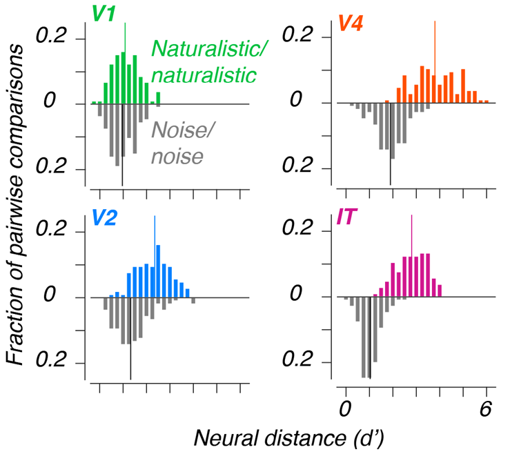

```{r setup, message = FALSE, warning = FALSE, echo = FALSE}
nb_id <- "20260715"
here::i_am(paste0("notebooks/", nb_id, "/", nb_id, ".qmd"))

library(dplyr)
library(tidyr)
library(here)
library(ggplot2)
library(qs2)
knitr::opts_chunk$set(echo = F, warning = F, message = T)

out_dir <- here("data", "processed", nb_id)
res_dir <- here("results", nb_id)
t2_dir <- here("data", "raw", "6reps") 
data_dir <- here("data", "processed", "20260625")
regions <- c("V1", "V2", "V4", "IT")

if (!dir.exists(out_dir)) dir.create(out_dir)
if (!dir.exists(res_dir)) dir.create(res_dir)

theme_set(theme_minimal(base_size = 9))
```

## Data

### Loading

See `20260625.qmd` for reference. For now, analysis will be limited to reliable sites and images with naturalistic structure. 

```{r}
avgs <- qs_read(here(data_dir, "avgs.qs2"))
resp_sites <- readRDS(here(data_dir, "resp_sites.RDS"))
stimuli <- read.csv(here(data_dir, "stimuli.csv"))

natur_idx <- stimuli$coherence == 2
avgs <- lapply(regions, 
  function(x) avgs[[x]][natur_idx, resp_sites[[x]]])
names(avgs) <- regions

stimuli <- stimuli[natur_idx, ] 
```

## Methods

### LDA-derived single dimensional distance

Lee et al. trained the population decoder by: 

1. Taking a training set of repetitions (15-fold CV separated by sample) (**this notebook**).
2. Projecting the population response to non-blank images onto the first several principal components. Gerick mentioned this step was omitted in later analyses. Performing LDA on the original data works fine and removes the issue of finding PCs for combinations of subjects.
3. Applying linear discriminant analysis (LDA) to find the axis separating the naturalistic and noisy textures. For between-family discrimination, this is replaced by finding the axis best separating the families.
4. Projecting held-out responses on the axis, then reporting the $d'$ on the resulting one-dimensional values.

```{r}
dprime <- function(x, grps, return_components = T) {
  idx <- grps == unique(grps)[1]
  mu_diff <- mean(x[idx]) - mean(x[-idx])
  sd_comb <- sqrt(0.5 * (var(x[idx]) + var(x[-idx])))
  
  if (return_components)
    return(list(mu = mu_diff, sd = sd_comb))
    
  mu_diff / sd_comb }
```

### Multivariate d'

Instead of first finding the LDA axis, a multivariate distance value can be calculated with the typical Mahalanobis distance formula, i.e., 
$$
d_M (\mathbf{x}, \mathbf{y}) = \sqrt{(\mathbf{x} - \mathbf{y})^\intercal \Sigma^{-1} (\mathbf{x} - \mathbf{y})},
$$
where $\mathbf{x}, \mathbf{y}$ correspond to the mean activity vectors for each group, taken with respect to each site. The pooled covariance matrix is the same as used in Hotelling's two-sample statistic, derived as
$$
\Sigma = 
\frac{(n_x - 1) \Sigma_x + (n_y - 1)\Sigma_y}{n_x + n_y - 2},
$$
where $\Sigma_x, \Sigma_y$ are the typical sample covariance matrices for each distribution. `Rfast` contains functions `Rfast::pooled.cov()` and `Rfast::mahala()` to support these calculations. 

For some reason, `Rfast::mahala()` differs from manually performing the matrix multiplications and I cannot find the source code explaining this discrepancy. For now, I'll default to manual matrix multiplication for the Mahalanobis calculation.

Furthermore, it might be worth looking at the values derived from the shrinkage estimators from `corpcor::invcov.shrink()`. Though there are enough trials to perform the normal matrix inversion for the between-family case, it is probably worth sanity checking the difference. 

### Variations in distance calculations

Due to the low number of repetitions per individual image (6 repetitions), it is probably untenable to train LDA on pairwise sample comparisons. For low repetition analyses, I'll apply random dichotomies to increase the power. 

LDA can be applied on:

1. Pairwise family comparisons with 15-fold CV (holdout is one of the sample IDs)
2. Random dichotomies within families with 6-fold CV (holdout is one of the repetition IDs)
3. Random dichotomies between families with 6-fold CV (similar to the previous variation but with samples taken from different families)

```{r}
kfold_dprime <- function(dat, grps, cv_grps, return_trn = T) {
  k_tsts <- lapply(unique(cv_grps), 
    function(grp) {
      trn_idx <- cv_grps != grp
      c(dprime_tst(dat, grps, trn_idx), k = grp) })

  # Reformat 
  if (return_trn) {
    dprimes <- lapply(k_tsts, 
      function(x) {
        rbind(
          x[["tst"]] %>% data.frame() %>% mutate(data_split = "tst"), 
          x[["trn"]] %>% data.frame() %>% mutate(data_split = "trn")) %>%
          mutate(k = x[["k"]])}) 
  } else {
    dprimes <- lapply(k_tsts, 
      function(x) data.frame(x[names(x) != "scaling"])) }
  
  dprimes <- do.call(rbind, dprimes) %>% 
    mutate(dprime = mu / sd, .before = k)
  
  scalings <- lapply(k_tsts, function(x) x[["scaling"]]) %>%
    do.call(rbind, .)
  
  return(list(dprimes = dprimes, scalings = scalings))
}

dprime_tst <- function(dat, grps, trn_idx, return_trn = T) {
  fit <- MASS::lda(x = dat, grouping = grps, subset = trn_idx)
  
  tst_scores <- predict(fit, dat[-trn_idx, ])$x
  tst_grps <- grps[-trn_idx]
  
  if (return_trn) {
    trn_scores <- predict(fit, dat[trn_idx, ])$x
    trn_grps <- grps[trn_idx]
    
    return(list(
      trn = dprime(trn_scores, trn_grps), 
      tst = dprime(tst_scores, tst_grps), 
      scaling = as.numeric(fit$scaling)))
  } else {
    return(c(
      dprime(tst_scores, tst_grps), 
      scaling = list(as.numeric(fit$scaling))))}
}
```

### Procedure for this notebook

I subsampled 30 sites for each region out of the reliable sites. Subsampling did not consider simultaneous recording, so the subsampled sites may include more than one array. I fit LDA with `MASS::lda()` and found the projections with the `x` output of `predict.lda()` on the test set. 

## Pairwise between-family distances

### LDA

For each family pair, data is saved as a list with: 

- `dprimes`: a data frame
  - `mu`: the difference in means
  - `sd`: the combined standard deviation
  - `data_split`: the `trn` or `tst` reading
  - `dprime`: the calculated Cohon's $d'$, found as `mu` / `sd`
  - `k`: the label for the fold in 15-fold CV (corresponding to 15 samples)
- `scalings`: a numeric $15 \times 73$ matrix corresponding to 15 samples by the number of sites (here, determined by the number of reliable sites)
- `group_ids`: a numeric vector containing the group IDs included in the pair

Within this notebook, I mostly sanity tested some of the procedures. See `scripts/pairwise_family.R` for the code. I ran the calculations in the Stats server. 

```{r, eval = F}
library(cli)
set.seed(20260715)

family_pairs <- combn(unique(stimuli$family), 2, simplify = F)
family_pairs <- family_pairs[1:10]

pf_dir <- here(out_dir, "pairwise_family")
if (!dir.exists(pf_dir)) dir.create(pf_dir)

pairwise_dprimes <- function(region, n_sites = 30) {
  if (!dir.exists(here(pf_dir, region))) {
    dir.create(here(pf_dir, region, "dprime"), recursive = T)
    dir.create(here(pf_dir, region, "scalings")) }
  
  dat <- avgs[[region]]
  sites <- sample(1:ncol(dat), n_sites)
  dat <- dat[, sites]

  res <- lapply(
    cli_progress_along(family_pairs), 
    function(i) {
      grp_ids <- family_pairs[[i]]
      idx <- stimuli$family %in% grp_ids
      
      # produce the 15-fold CV results for each pair
      res <- kfold_dprime(
        dat = dat[idx, ], 
        grps = factor(stimuli$family[idx]), 
        cv_grps = stimuli$id[idx]) 
      
      # save each result separately
      f_nm <- paste0(paste0(grp_ids, collapse = "vs"), ".csv")
      colnames(res$scalings) <- sites
      
      write.csv(res$dprimes, here(pf_dir, region, "dprime", f_nm), row.names = F)
      write.csv(res$scalings, here(pf_dir, region, "scalings", f_nm), row.names = F)
})}
```

```{r, eval = F}
dummy <- lapply(regions, pairwise_dprimes)
```

$d'$ values are reported as the average across the 15 folds. See @fig-dprime for histograms of the pairwise comparison $d'$ values (subsampled for 30 sites), separated by region. The trend in the results seem consistent with Gerick's poster (copied in @fig-areadne2024 for reference), with the center of the histogram generally tending toward higher $d'$ with higher visual regions with the trend reversing in IT. Both the difference in means and combined SD tend to increase with higher visual regions, again with the trend reversing in IT. This may indicate that for V1 to V2 to V4, the firing patterns tend to be more spread out, with the increased variance compensated by better separation of the groups. There does not seem to be a notable difference in train and test $d'$ (@fig-dprime, right).  

Though the relative differences in $d'$ distributions seem similar to Gerick's previous results, the scales are inconsistent, with Gerick finding $d'$ values as high as around 6 for V4 (my max: 1.3). Possibly, he calculated LDA on averages over repetitions, thus lowering the combined SD (the denominator of the $d'$). It may also be due to differences in the number of sampled sites. 

```{r}
regions <- c("V1", "V2", "V4", "IT")
fold_avgs <- here(res_dir, "pairwise_family_avgs.csv") %>% 
  read.csv() %>%
  mutate(
    region = factor(region, levels = regions),
    dprime = abs(dprime), 
    mu = abs(mu))
```

```{r}
#| label: fig-dprime
#| fig-cap: "Histogram of d', mean differences, combined SD, and train-test difference for each pairwise family comparison, separated by region. Vertical line indicates the median."
#| fig-width: 5.5
#| fig-height: 4

library(patchwork)
dprime_summary <- fold_avgs %>%
  filter(data_split == "tst") %>%
  group_by(region) %>%
  summarize(across(c("mu", "sd", "dprime"), median))

p_d <- fold_avgs %>%
  filter(data_split == "tst") %>%
  ggplot(aes(x = dprime)) + 
    geom_histogram(bins = 20, fill = palette.colors()[3]) + 
    facet_wrap(vars(region), ncol = 1, scales = "fixed") + 
    labs(y = NULL, x = "Pairwise family d'") + 
    geom_vline(data = dprime_summary, aes(xintercept = dprime), linetype = "dashed") + 
    theme(axis.text.y = element_blank(), panel.grid.minor = element_blank())

p_mu <- fold_avgs %>%
  filter(data_split == "tst") %>%
  ggplot(aes(x = mu)) + 
    geom_histogram(bins = 20, fill = palette.colors()[2]) + 
    facet_wrap(vars(region), ncol = 1, scales = "fixed") + 
    labs(y = NULL, x = "Mean diff.") + 
    geom_vline(data = dprime_summary, aes(xintercept = mu), linetype = "dashed") + 
    theme(axis.text.y = element_blank(), panel.grid.minor = element_blank())

p_sd <- fold_avgs %>%
  filter(data_split == "tst") %>%
  ggplot(aes(x = sd)) + 
    geom_histogram(bins = 20, fill = palette.colors()[4]) + 
    facet_wrap(vars(region), ncol = 1, scales = "fixed") + 
    labs(y = NULL, x = "Combined SD") + 
    geom_vline(data = dprime_summary, aes(xintercept = sd), linetype = "dashed") + 
    theme(axis.text.y = element_blank(), panel.grid.minor = element_blank())

p_tt <- fold_avgs %>%
  dplyr::select(-sd, -mu) %>%
  tidyr::pivot_wider(
    names_from = data_split,
    values_from = dprime) %>%
  mutate(trn_tst_diff = trn - tst) %>%
  ggplot(aes(x = trn_tst_diff)) +
    geom_histogram(bins = 20, fill = palette.colors()[6]) +
    facet_wrap(vars(region), ncol = 1, scales = "fixed") +
    labs(y = NULL, x = "Train - test d'") +
    theme(axis.text.y = element_blank(), panel.grid.minor = element_blank())

p_d | p_mu | p_sd | p_tt
```

{#fig-areadne2024 width=40%}

```{r}
avg_folds <- function(dprimes) {
  dprimes %>% 
    group_by(data_split) %>%
    summarize(avg = mean(dprime), sd = sd(dprime))
}

avg_file <- function(f_nm, dir_nm = ".") {
  group_ids <- f_nm %>%
    basename() %>%
    tools::file_path_sans_ext() %>%
    strsplit("vs") %>% 
    unlist()
  
  file.path(dir_nm, f_nm) %>%
    read.csv() %>%
    avg_folds() %>%
    mutate(grp1 = group_ids[1], grp2 = group_ids[2])
}

avg_region_dir <- function(region, dir_nm = "data") {
  dprime_dir <- here(dir_nm, region, "dprime")
  f_nms <- list.files(dprime_dir)
  
  lapply(f_nms, avg_file, dir_nm = dprime_dir) %>%
    do.call(rbind, .) %>%
    mutate(region = region)
}
```

## Multivariate distance

In addition to the calculated $d'$ values, I will also be saving the mean distances and the combined variances (the diagonal of the combined covariance matrix). There does not seem to be a marked difference in the distribution of the Mahalanobis distances with or without shrinkage during estimation of the covariance matrix (@fig-mahalanobis_shrinkage). Furthermore, while the calculated distances tend to increase with more sub-sampled sites, the overall trend in the distributions of the distance values is consistent (@fig-mahalanobis_sites).

```{r}
pf_dir <- here(out_dir, "pairwise_family")
read_multi_d <- function(d_dir, shrink = T, n_sites = 30) {
  md_dir <- ifelse(shrink, "multi_d_shrink", "multi_d")
  lapply(
    regions, 
    function(region) {
      here(d_dir, md_dir, paste("n", n_sites, sep = ""), region, "dprime.csv") %>%
        read.csv() %>%
        mutate(region = region) }) %>%
    do.call(rbind, .) %>%
    mutate(
      region = factor(region, levels = regions), 
      n_sites = n_sites,
      shrink = shrink)
}

multi_ds <- apply(
  expand.grid(list(shrink = c(T, F), n_sites = 10 * 1:4)), 1, 
  function(x) read_multi_d(pf_dir, x[1], x[2])) %>%
  do.call(rbind, .) %>%
  mutate(shrink = as.character(shrink)) %>%
  mutate(shrink = replace_values(shrink, "1" ~ "Shrinkage", "0" ~ "Ordinary"))

write.csv(multi_ds, here(res_dir, "pf_dM.csv"), row.names = F)
```

```{r}
read_mu_var <- function(d_dir, shrink = T, n_sites = 30) {
  md_dir <- ifelse(shrink, "multi_d_shrink", "multi_d")
  lapply(
    regions, 
    function(region) {
      mu_diff <- here(
        d_dir, md_dir, paste("n", n_sites, sep = ""), region, "mu_diff.csv") %>%
        read.csv() %>%
        apply(., MARGIN = 1, mean) %>%
        data.frame(val = ., region = region, measure = "mu_diff") 
      combvar <- here(
        d_dir, md_dir, paste("n", n_sites, sep = ""), region, "combvar.csv") %>%
        read.csv() %>%
        apply(., MARGIN = 1, mean) %>%
        data.frame(val = ., region = region, measure = "combvar") 
      rbind(mu_diff, combvar)
    }) %>%
    do.call(rbind, .) %>%
    mutate(
      region = factor(region, levels = regions), 
      n_sites = n_sites,
      shrink = shrink)
}
dM_mu_var <- apply(
  expand.grid(list(shrink = c(T, F), n_sites = 10 * 1:4)), 1, 
  function(x) read_mu_var(pf_dir, x[1], x[2])) %>%
  do.call(rbind, .) %>%
  mutate(shrink = as.character(shrink)) %>%
  mutate(shrink = replace_values(shrink, "1" ~ "Shrinkage", "0" ~ "Ordinary"))
write.csv(dM_mu_var, here(res_dir, "pf_dM_mu_var.csv"), row.names = F)
```


```{r}
#| label: fig-mahalanobis_shrinkage
#| fig-cap: "Histogram of Mahalanobis distances with the ordinary covariance estimate (left) or the shrinkage estimator (right) with samples of 30 sites."
#| fig-width: 3
#| fig-height: 2.5
dprime_summary <- multi_ds %>%
  group_by(region, shrink, n_sites) %>%
  summarize(across(c("multi_d"), median), .groups = "drop_last")

multi_ds %>% 
  filter(n_sites == 30) %>%
  ggplot(aes(x = multi_d)) + 
    geom_histogram(bins = 20, fill = palette.colors()[3]) + 
    facet_grid(rows = vars(region), cols = vars(shrink), scales = "fixed") + 
    labs(y = NULL, x = "Mahalanobis distance") + 
    geom_vline(data = dprime_summary %>% filter(n_sites == 30), aes(xintercept = multi_d), linetype = "dashed") + 
    theme(axis.text.y = element_blank(), panel.grid.minor = element_blank())
```

```{r}
#| label: fig-mahalanobis_sites
#| fig-cap: "Histogram of Mahalanobis distances with different numbers of sampled sites. Results are taken from the ordinary (no shrinkage) covariance estimator."
#| fig-width: 4.5
#| fig-height: 2.5
multi_ds %>% 
  filter(shrink == "Ordinary") %>%
  ggplot(aes(x = multi_d)) + 
    geom_histogram(bins = 20, fill = palette.colors()[2]) + 
    facet_grid(rows = vars(region), cols = vars(n_sites), scales = "fixed") + 
    labs(y = NULL, x = "Mahalanobis distance") + 
    geom_vline(
      data = dprime_summary %>% filter(shrink == "Ordinary"), 
      aes(xintercept = multi_d), linetype = "dashed") + 
    theme(axis.text.y = element_blank(), panel.grid.minor = element_blank())
```
