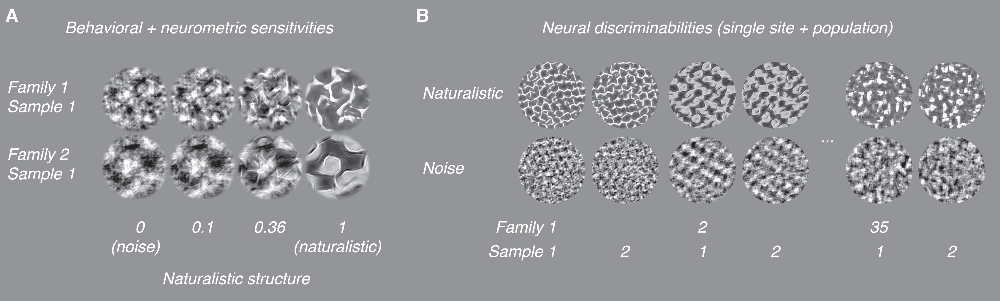

```{r, message = FALSE, warning = FALSE}
nb_id <- "20260630"
here::i_am(paste0("reports/", nb_id, "/", nb_id, ".qmd"))

library(here)
library(dplyr)
library(tidyr)
library(ggplot2)
library(gt)

knitr::opts_chunk$set(echo = F, warning = F, message = F)

# ggplot settings
theme_set(theme_minimal(base_size = 9))
```

## Introduction

In my ADA, I am analyzing data provided by Gerick Lee et al. (2024) containing longitudinal and inter-region neural responses to visual texture stimuli (available on [Zenodo](https://zenodo.org/records/10888270)) [@lee_developmentally_2024]. Lee et al. recorded from 6 macaques with two arrays each, targeting V1, V2, V4, and IT.

My goal is to characterize encoding differences between texture groups between regions, where groups are unique coherence-family combinations (70 groups), i.e., samples with similar visual statistics. Ziemba et al. (2016) performed a similar analysis on recordings from V1 and V2 [@ziemba_selectivity_2016], discussed further in @sec-lit. Relatedly, Okazawa et al. (2015, 2017) compared the selectivity of V2 and V4 neurons for image statistics in texture stimuli [@okazawa_image_2015; @okazawa_gradual_2017]. Other analyses of between-region texture responses focused on discrimination between noisy and naturalistic structure or selectivity for natural structure [@freeman_functional_2013; @lee_developmentally_2024; @lee_emergence_2025], generally finding better discrimination of coherence in V2 and V4.  

We expect to find better between-group discrimination in V2 and V4, consistent with previous work characterizing selectivity to noisy/naturalistic structure in these brain regions. Furthermore, we also expect better within-group discrimination in V1, i.e., more separation between unique samples with the same visual statistics. That is, later visual regions better encode relevant group-level visual statistics at the cost of distinctively encoding individual instances of textures with the same statistics. 

### Notes

- Consecutive question marks (??) tag areas to follow up on.
- Though the Lee et al. paper and related literature describes textures without V1-like correlations as "noise", I often use the term "noisy".
- Unless otherwise specificed, $d'$ is Cohon's $d$, i.e., $d' = \frac{\mu_1 - \mu_0}{\sqrt{(\sigma^2_1 + \sigma^2_0)/2}}$.
- The published data only includes multi-unit activations (MUAs) for each recording site, but I may refer to these as neurons or cells. 
- @sec-data mostly copies information from the previous report.

## Analysis plan

For a simple analysis, I plan to calculate the $d'$ between all group pairs (i.e., $\binom{70}{2} = 2415$ pairs per region) and the one-vs-rest $d'$ for all individual sites. For the within-family spread, I could calculate the pairwise or one-vs-rest $d'$ again, or perform a nested ANOVA analysis (used in [@ziemba_selectivity_2016]). I do not have a concrete plan for quantifying the between-region differences from these distances; I'll start with a histogram to visualize it. Dimensionality reduction techniques like PCA or t-SNE (used in [@ziemba_selectivity_2016]) could also help visualize the data structure and identify clustering.  

For population analyses, obstacles include identifying reliable sites and correcting for different population sizes between regions. Prior work by Lee et al. (2024, 2025) applied population decoding techniques to characterize noisy/naturalistic discriminability [@lee_developmentally_2024; @lee_emergence_2025]. To find visually responsive (reliable) sites, Lee et al. averaged the site response within samples with the same image statistics (so $35 \times 2$ coherence-family combinations plus one element for blank) then kept sites with a correlation of $\rho \geq 0.4$ between even and odd repetitions. They accounted for different population sizes by repeatedly subsampling sites. See @sec-lit for the procedure to calculate the population $d'$.

Another likely difficulty will be detecting any signal in IT recordings, and I may need to consider other techniques to characterize IT (e.g., manifold learning). Though if nothing shows up with simpler techniques, I suspect it would be due to the quality of the data rather than the method.

## Prior work {#sec-lit}

At AREADNE 2024, Gerick presented a poster covering some family discrimination results on this data. They "measured population distances between different texture families (noise vs. noise, or naturalistic vs. naturalistic), using the same population decoder", with results of pairwise comparisons in @fig-areadne2024. Lee et al. trained the population decoder by: 

1. Taking a training set of repetitions (15-fold CV separated by sample). 
2. Projecting the population response to non-blank images onto the first several principal components. Gerick mentioned this step was omitted in later analyses. Performing LDA on the original data works fine.
3. Applying linear discriminant analysis (LDA) to find the axis separating the naturalistic and noisy textures. For between-family discrimination, this is replaced by finding the axis best separating the families.
4. Projecting held-out responses on the axis, then reporting the $d'$ on the resulting  values.

{#fig-areadne2024 width=40%}

I will be using Gerick's work as a template for my population analysis approach, though I would also include naturalistic vs. noisy family comparisons. 

As mentioned above, this ADA direction is similar to Ziemba et al. (2016), though their experiment did not include noisy texture stimuli or recordings from V4/IT [@ziemba_selectivity_2016]. They found the following result:

> For populations of up to 100 cells, V1 neurons supported better performance in the sample identification task, whereas V2 neurons exhibited better performance in texture classification. Relative to V1, the responses of V2 show greater selectivity and tolerance for the representation of texture statistics.

Ziemba et al. (2016) performed a nested ANOVA to partition response variance into between-family, within-family, and within-image (repetition) contributions. Ziemba et al. (2016) also compared the performance of a Poisson decoder on classifying samples or families, though their data contained the same number of families and samples within families (15 families, 15 samples). This might be viable, but I would need to subsample groups to make the classification results comparable. 

## Data {#sec-data}

Monkeys were presented with textures generated from the PS parametric texture model [@portilla_parametric_2000], with unique images created from 2 levels of coherence (noisy/naturalistic), 35 families (seed images), and 15 randomly generated samples from each family (1050 unique images) Each region (V1, V2, V4, IT) has at least one 96 electrode array with data as multi-unit activations. There are six repetitions of each image per session. 

### Texture stimuli from the PS model

Textures were generated from the Portilla and Simoncelli (PS) parametric texture model, a multilevel generative model that produces sample images by matching visual statistics to an original seed image [@portilla_parametric_2000]. The lowest level of the model matches the local statistic of the original image, e.g., the correlation in luminance between adjacent pixels, the average luminance in a small area, or the total variation in luminance. Subsequent layers control higher level correlations, e.g., correlations between neighboring patterns of pixels. 

Portilla and Simoncelli describe the higher levels as V1-like, or analogous to the receptive fields of the primary visual cortex. Matching V1-like correlations produces more coherent *naturalistic* structure. Example noisy and naturalistic images can be seen in @fig-textures (left). Though the degree of naturalistic structure varied in the behavioral task, the passive fixation recordings only contained noisy/zero strength textures or full strength naturalistic textures. Lee et al. generated 15 samples of noisy and naturalistic images from 35 families ($15 \times 35 \times 2$ unique images), where each family corresponded to a different original seed image. The parameters fed into the PS model are likely lost, but the images presented to the monkeys may be available (??).

{#fig-textures width=90%}

### Passive fixation recording

Lee et al. recorded from 6 monkeys, each implanted with two 96-site Utah arrays. Within a session, there were 6 repetitions of each of the $35 \times 15 \times 2 = 1050$ unique images, presented in blocks of 8 images (100 ms on, 100 ms off). The provided files aggregate recordings by region, with the number of sites per region in @tbl-sites. For each of V1, V2, V4, and IT, there is at least one 96-electrode Utah array. The published per-session data reflects simultaneously recorded sites. 

On M1, one array sat on the border between V1 and V2. For M3, the authors could not reliably determine the location and labeled the region as the foveal confluence (FC) of V1, V2 and V4, which I removed from my analyses. Lee et al. implanted IT arrays twice in M6, with the recording at 221 weeks taken from the second implantation. 

| Region | Array 1 | Array 2 | Array 3 | Array 4 | Total |
|----|----|----|----|----|----|
| V1 | 61 (M1) | 96 (M6) |         |         | 157 |
| V2 | 35 (M1) | 96 (M2) |         |         | 131 |
| V4 | 96 (M1) | 96 (M2) | 96 (M8) |         | 288 |
| IT | 96 (M3) | 96 (M6) | 96 (M6) | 96 (M7) | 384 |

: The array number is arbitrary. Monkey ID is in parentheses. {#tbl-sites font-size=80%}

### Behavioral discrimination between noisy and naturalistic textures

In addition to passive fixation recordings, Lee et al. also measured behavioral sensitivities with a four-choice oddity task. Monkeys were shown 3 noisy distractors and 1 naturalistic target, with all four images produced from the same family. The noisy distractors were unique samples, i.e., not replicates of the same noisy image. The strength of naturalistic structure in the target could be modified from 0 (statistically matched to noisy texture) to 1 (fully matches the naturalistic structure statistics of the seed image). Of the 35 texture families presented in passive fixation recordings, samples from only five families were used in the behavioral task. The family IDs in the behavioral task are included in the public MATLAB code. M8 only underwent passive fixation recording and did not perform the four-choice oddity task. M1, M2, and M3 performed the behavioral task prior to recording while M6 and M7 performed the task after. 

## References

::: {#refs}
:::

