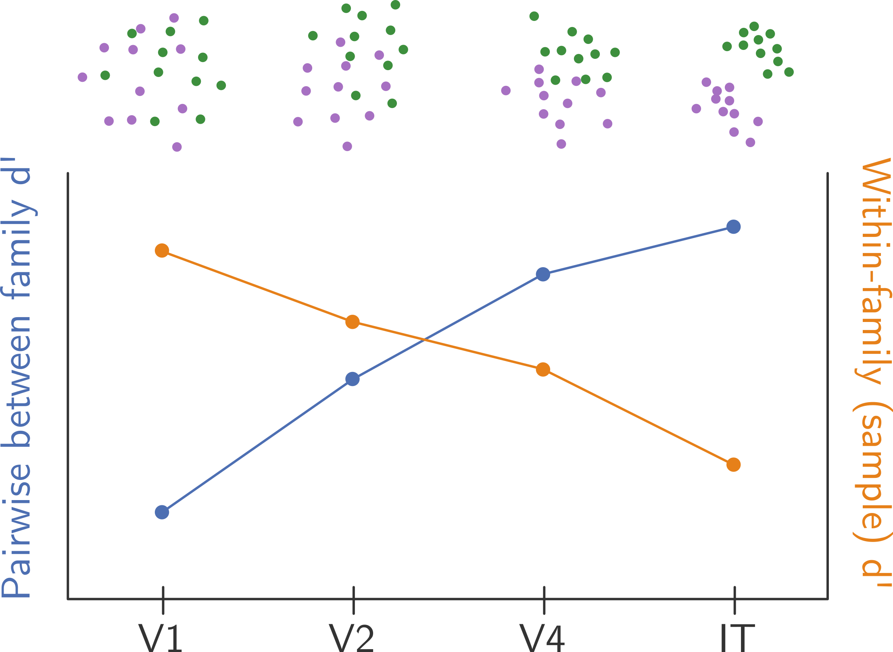

```{r, message = FALSE, warning = FALSE}
library(here)
nb_id <- "20260819"
here::i_am(paste0("reports/", nb_id, "/", nb_id, ".qmd"))

library(here)
library(dplyr)
library(tidyr)
library(ggplot2)
library(gt)

library(patchwork)
library(qs2)

knitr::opts_chunk$set(echo = F, warning = F, message = F)

# ggplot settings
theme_set(theme_minimal(base_size = 9))
```

### Notes

- Bullet points indicate areas of incomplete writing/draft reasoning. 
- Consecutive question marks (??) tag areas to follow up on.
- Though the Lee et al. paper and related literature describes textures without V1-like correlations as "noise", I often use the term "noisy".
- For multivariate distance, I use Mahalanobis distance, indicated as $d_M$

## Introduction

### Motivation

Later stages of the visual cortex are thought to contain neurons selective for progressively higher-level visual features. 

- The primary visual cortex (V1), for instance, contains neurons that selectively respond to small image features, e.g., oriented edges. 
- The feature tuning in the subsequent areas of the secondary visual cortex (V2) and visual area V4 is less well-characterized. Broadly, V2 contains neurons selective for texture features and V4 contains neurons selective for geometric forms. 
- The inferior temporal gyrus (IT), which handles later visual processing, contains areas selective for object categories, such as the fusiform face area for facial recognition. 
- (??) The above is mostly from memory and may need to be fact-checked. E.g., the wording of "feature tuning" and "selectively respond" may need to be more careful. "Sensitive" might be more appropriate.   

One approach to characterize the relevant visual features for each layer is through characterizing responses to visual textures with known image statistics. Visual textures can be loosely described as approximately homogeneous images with repeating but randomized elements, e.g., images of sand, tree bark, granite, or honeycomb. Here, image statistics refer to $N$th-order empirical densities of pixels. First order statistics include, for example, luminance correlations at a given distance. 

- *Why visual textures?* The theory of visual texture perception assumes that texture classes can be parameterized by a set of image statistics. If texture samples are within the same family, they should elicit comparable responses in the visual area where texture processing "occurs", even if the images are physically distinct. 
- Furthermore, the homogeneity in textures helps control for the different sizes of receptive fields in each visual area, since within some reasonable range, the statistics are consistent in differently sized slices of the textures.   

Portilla and Simoncelli (2000) [@portilla_parametric_2000] developed a parametric texture model that, given a seed image of a visual texture, generates new samples matched to the original's image statistics. The parametric model can be adjusted to include higher-order statistics, which Portilla and Simoncelli describe as V1-like. Matching V1-like correlations produces more coherent *naturalistic* structure. Example noisy (no V1-like statistic matching) and naturalistic images can be seen in @fig-textures. Freeman et al. (2013) found that this distinction may be relevant for functionally characterizing V2, finding that V2 neurons tend to be more selective for naturalistic textures [@freeman_functional_2013]. 

{#fig-textures width=90%}

My ADA will focus on further characterizing how image statistics may be represented/transformed in V1, V2, V4, and IT, using data collected by Lee et al. (2024) [@lee_developmentally_2024]. V4 and IT are not usually recorded for visual texture stimuli, as higher level areas tend to respond more sparsely to textures. Each family contains samples that are matched to the same statistics, but each sample is unique at a pixel level. Thus, if higher layers are selective for certain higher level aggregated image statistics, we expect that they will lose selectivity for the differences between samples. 

- As a follow-up to Lee et al. (2024), Gerrick Lee explored this question by comparing the distributions of pairwise between-family distances in each visual area, seen in (@fig-areadne2024). Consistent with their results finding better decoding of naturalistic vs. noisy texture in V2 and V4, these areas show greater pairwise distances between naturalistic texture families compared to V1. 
- Distances in IT are smaller than V4, though I would like to explore whether this result is robust to corrections for the sparseness of responses to textures in IT. 
- "Sparseness" is loosely defined here, as there are different scenarios that could be described as "sparse". E.g., "site-sparseness", where a few IT neurons reliably respond to texture families, or "image-sparseness", where for a given image, there are a few neurons whose response is reliable, but the responsive neurons for each image may differ.

{#fig-areadne2024 width=40%}

### Data

I sourced data from Gerick Lee et al. (2024), who collected longitudinal and inter-region neural responses to visual texture stimuli (available on [Zenodo](https://zenodo.org/records/10888270)) [@lee_developmentally_2024]. Lee et al. recorded from 6 macaques with two arrays each, targeting V1, V2, V4, and IT. Lee et al. reported the multi-unit activations (MUAs); the spiking/raw timing data are not available. Lee et al. generated 15 samples of noisy and naturalistic images from 35 families ($15 \times 35 \times 2$ unique images), where each family corresponded to a different original seed image. The parameters fed into the PS model are lost, but the images presented to the monkeys may be available.

### Expected results

We expect to find better between-group discrimination in V2 and V4 better within-group discrimination in V1, i.e., more separation between unique samples with the same visual statistics. That is, later visual regions better encode relevant group-level visual statistics at the cost of distinctively encoding individual instances of textures with the same statistics (see @fig-intro). This effect is likely only visible in population level metrics or decoding strategies considering the relative size of the receptive fields. Previously, Ziemba et al. (2016) performed a similar analysis on recordings from V1 and V2 [@ziemba_selectivity_2016]. With nested ANOVA, Ziemba et al. found larger between-family variance in V1 but smaller within-family contribution to variance. Ziemba et al. (2016) also found better performance of a Poisson decoder on classifying samples in V1 (and families in V2). Furthermore, for IT, it is possible that both between-family and within-family distance decreases as IT may not be sensitive to the image statistics that distinguish the textures, a pattern found in Gerick Lee's previous analysis (@fig-areadne2024).

{#fig-intro width=60%}


## Analysis plan and methods

### Reliable site detection, onset time, and MUA averaging

To find visually responsive (reliable) sites, I followed Lee et al.'s procedure. They averaged the site response within samples with the same image statistics (so $35 \times 2$ coherence-family combinations plus one element for blank) then kept sites with a correlation of $\rho \geq 0.4$ between even and odd repetitions. They accounted for different population sizes by repeatedly subsampling sites. Lee et al. defined the onset time for a site as the first time bin with a $|d'| \geq 0.4$ between non-blank and blank stimuli where the two subsequent windows also produced $|d'| \geq 0.4$ of the same sign (see @eq-dprime for the definition of $d'$, which is Cohon's distance metric). 

$$
d' = \frac{\mu_1 - \mu_0}{\sqrt{(\sigma^2_1 + \sigma^2_0)/2}}
$$ {#eq-dprime}

The procedure for summarizing data can be outlined as:

1. Find a temporary population onset time, with $d'$ calculated between blanks and stimuli. The search window is 0 to 200 ms after stimulus presentation. If no onset time is found, use 100 ms as a placeholder. 
2. Determine the responsive sites with signals averaged over a 150 ms window starting at the temporary onset time. 
3. Recalculate the population onset time based on the responsive sites.
4. For downstream analyses, sum responses across the 150 ms window after population onset time. 

### Distance metric for separation

To determine the between-family or between-sample separation within regions, I will find the distribution of multivariate distance values between pairwise comparisons. This approach will allow for visualization of the median/mean pairwise distribution and the skew of the distances.

A multivariate distance value can be calculated with the typical Mahalanobis distance formula, i.e., 
$$
d_M (\mathbf{x}, \mathbf{y}) = \sqrt{(\mathbf{x} - \mathbf{y})^\intercal \Sigma^{-1} (\mathbf{x} - \mathbf{y})},
$$
where $\mathbf{x}, \mathbf{y}$ correspond to the mean activity vectors for each group, taken with respect to each site. The pooled covariance matrix is the same as used in Hotelling's two-sample statistic, derived as
$$
\Sigma = 
\frac{(n_x - 1) \Sigma_x + (n_y - 1)\Sigma_y}{n_x + n_y - 2},
$$
where $\Sigma_x, \Sigma_y$ are the typical sample covariance matrices for each distribution. `Rfast` contains functions `Rfast::pooled.cov()` and `Rfast::spdinv()` to support these calculations. For low trial numbers, the inverse covariance matrix can be found with the regularized/shrinkage estimator from `corpcor::invcov.shrink()`. 

For between-family calculations, each family contains 90 trials (15 samples by 6 repetitions each). For between-sample distance calculations, each sample only contains 6 repetitions. So, while pairwise between-family calculations are straightforward, the between-sample distances may need to be modified and explored more. 

Jenelle proposed a randomized dichotomy procedure. Two groups of 7 sample IDs each (without replacement) will be selected. Because this is not an even split of the available sample IDs, the procedure will proceed as follows: 

1. Omit one of the 15 IDs (1, 2, ..., 15)
2. Take a random sample of the possible $\binom{14}{7}$ combos of the remaining indices.
3. Find $d_M$ between the two groups of seven samples (so 42 trials) each. 
4. Repeat the above for each of the 15 IDs.

Alternatively, we could still perform pairwise between-sample calculations (with the regularized/shrinkage estimator) and discuss trends visible within families.

- (??) The estimated variance matrix in $d_M$ could also be an area of analysis; I have not thought about this in much detail, besides decomposing $\Sigma$ on PCs. 
- (??) While looking at this section and @sec-sparseness, I realized a possible methodological mistake. Lee et al. did not separate sites across arrays/monkeys for their population decoder training, which I repeated in my sampling of sites. However, considering the pooled $\Sigma$ in $d_M$ and the visible differences between sites from different arrays, I probably need to rethink my analysis to be array-specific or think more about the caveats to not separating analyses by array. 

### Sparseness characterization

- (??) I'm returning to this more exploratory question since I glossed over it in the reliable site detection method applied previously. 

Very few investigators record visual texture responses from IT due to the lack of a strong, coherent response. *A priori*, we should expect a sparse response in IT. There are a few ways that sparseness may appear in IT:  

1. There are a few IT neurons whose responses to the texture families tend to be strong and reliable. 
2. For each texture family, there are a few neurons whose response is reliable, but the responsive neurons for each family may differ.
3. For some texture families, there are a few neurons whose response is reliable. 
4. Same as (3), but for each specific image (sample ID). 
5. Same as (3), but for each specific image.

- Because reliable sites are identified by correlation to the same stimuli, it is possible to consistently miss patterns of sparsity outside of (1) in my previously described procedure. 
- Since scenario (5) is most general, we want to focus on approaches to characterize the neural response that would work in this situation. 
- The most basic analysis is to perform a two sample Welch's t-test for each neuron's response for a specific image compared to the response to blank images. 
- Visualizing the main components of the *t*-test (the difference in means and the standard deviations) would also be useful. 

The statistic *t* is found as 
$$
t = \frac
{ \overline{X}_1 - \overline{X}_2 }
{ \sqrt{s^2_{\overline{X}_1} + s^2_{\overline{X}_2}} }, 
\quad 
s_{\overline{X}_i} = \frac{s_i}{\sqrt{n_i}}
$$
where $\overline{X}_i$ is the sample mean, and $s_{\overline{X}_i}$ is the standard error, $s_i$ is the sample standard deviation, and $n_i$ is the sample size. The *t*-distribution's degrees of freedom can be approximated as
$$
\nu \approx \frac
{ \left( s^2_{\overline{X}_1} + s^2_{\overline{X}_2} \right)^2 }
{ \frac{s^4_{\overline{X}_1}}{n_1 - 1} + \frac{s^4_{\overline{X}_2}}{n_2 - 1} }.
$$
For simplicity, this will be implemented by `t.test()`. 

### Holding out data

- (??) Based on exploratory data analysis to characterize sparseness (@sec-sparseness), it will be difficult to hold out subjects (arrays) for analysis.
- There are probably not enough samples in V1, since one of the two arrays contains only around 30 sites. 
- The sparseness of responses in IT could pose an issue even though it contains the most sites, since I would visually estimate only a bit more than 1% of the sites usefully respond to textures. 

## Data {#sec-data}

Monkeys were presented with textures generated from the PS parametric texture model [@portilla_parametric_2000], with unique images created from 2 levels of coherence (noisy/naturalistic), 35 families (seed images), and 15 randomly generated samples from each family. This produces 1050 unique images ($35 \times 2 \times 15$). There are six repetitions of each image per session. 

Lee et al. recorded from 6 monkeys, each implanted with two 96-site Utah arrays. Within a session, there were 6 repetitions of each of the $35 \times 15 \times 2 = 1050$ unique images, presented in blocks of 8 images (100 ms on, 100 ms off). The provided files aggregate recordings by region, with the number of sites per region in @tbl-sites. For each of V1, V2, V4, and IT, there is at least one 96-electrode Utah array. The published per-session data reflects simultaneously recorded sites. 

On M1, one array sat on the border between V1 and V2. For M3, the authors could not reliably determine the location and labeled the region as the foveal confluence (FC) of V1, V2 and V4, which I removed from my analyses. Lee et al. implanted IT arrays twice in M6, with the recording at 221 weeks taken from the second implantation. 

| Region | Array 1 | Array 2 | Array 3 | Array 4 | Total |
|----|----|----|----|----|----|
| V1 | 61 (M1) | 96 (M6) |         |         | 157 |
| V2 | 35 (M1) | 96 (M2) |         |         | 131 |
| V4 | 96 (M1) | 96 (M2) | 96 (M8) |         | 288 |
| IT | 96 (M3) | 96 (M6) | 96 (M6) | 96 (M7) | 384 |

: The array number is arbitrary. Monkey ID is in parentheses. {#tbl-sites font-size=80%}

## Initial results

### Per-site responses to families and samples {#sec-sparseness}

In @fig-fam, the heat map of mean differences and standard deviations helps visualize the per-site and per-family distribution of firing patterns. 

- Vertical striping in the heat maps indicates per-site differences and horizontal striping in the heat maps indicates per-image differences. 
- Even with this basic visualization, the divisions between each array tend to be clear, with the exception of V2. For instance, in V4, the second array (i.e., the 96 columns in the center of the heat maps) shows markedly lower differences in means and standard errors. 
- Overall, the difference in means between family responses and blank images tends to be lower in IT. 
- In the left sites for IT, there appear to be some indications that there are a few sites that respond well to some families and thus may be discarded if reliable sites are detected with correlation across all families. 

```{r}
#| label: fig-fam
#| fig-cap: "Difference in mean response (left) and standard deviations (right) of responses to texture families. IT generally shows lower and less variable differences in mean firing rates but a wide distribution of standard deviations. All regions show horizontal banding, indicating consistent per-family response patterns that are consistent across sites."
#| fig-width: 4.5
#| fig-height: 4

regions <- c("V1", "V2", "V4", "IT")
blank_wide <- qs_read(here("data", "processed", "20260813", "blank_wide.qs2"))

fam_firing <- qs_read(here("data", "processed", "20260813", "fam_firing.qs2")) %>% 
  left_join(blank_wide, by = c("site", "region")) %>%
  mutate(mu_diff = mu - mu_blank, .before = sd) %>%
  select(-mu_blank, -sd_blank) %>%
  pivot_longer(mu:sd, names_to = "nm", values_to = "val") %>%
  mutate(val = val * 100) %>%
  filter(nm != "mu") %>%
  mutate(nm = replace_values(nm, 
    "mu_diff" ~ "Difference in means", 
    "sd" ~ "Standard deviation")) %>%
  # mutate(nm = replace_values(nm, 
  #   "mu_diff" ~ "Diff. in means", 
  #   "sd" ~ "Std. dev.")) %>%
  mutate(region = factor(region, levels = regions))

# p_fam_1 <- fam_firing %>%
#   filter(nm == "Diff. in means") %>%
#   ggplot(aes(x = site, y = fam, fill = val)) + 
#     geom_raster() + 
#     facet_wrap(vars(region)) + 
#     scale_fill_continuous(palette = "viridis") + 
#     labs(x = NULL, y = "Family", fill = "Mean diff. (Hz)") + 
#     theme(
#       panel.grid = element_blank(), 
#       axis.text.x = element_blank(), 
#       axis.text.y = element_blank()) 
# 
# p_fam_2 <- fam_firing %>%
#   filter(nm == "Std. dev.") %>%
#   ggplot(aes(x = site, y = fam, fill = val)) + 
#     geom_raster() + 
#     facet_wrap(vars(region)) + 
#     scale_fill_continuous(palette = "magma") + 
#     labs(x = "Site", y = "Family", fill = "SD (Hz)") + 
#     theme(panel.grid = element_blank(), axis.text.y = element_blank())
# 
# p_fam_1 / p_fam_2

fam_firing %>%
  ggplot(aes(x = site, y = fam, fill = val)) + 
    geom_raster() + 
    facet_grid(rows = vars(region), cols = vars(nm)) + 
    scale_fill_continuous(palette = "magma") + 
    labs(x = "Site", y = "Family", fill = "Hz") + 
    theme(
      panel.grid = element_blank(), 
      axis.text.y = element_blank())
```

@fig-img contains the per-site and per-image firing distributions as the difference in means and the standard deviation, analyzing firing over repetitions of the exact same image rather than samples in the same family. 

- V2 and V4 show more between-site and between-image variation, consistent with previous results on decoding texture families in these regions. 
- The overall trends are similar to @fig-fam. 
- The horizontal banding (between-image variation) is somewhat more visible in IT, providing further support that IT responses are both sparse between sites and between images.

```{r}
#| label: fig-img
#| fig-cap: "Difference in mean response (left) and standard deviations (right) of responses to specific images, with samples in the same family in adjacent rows. V2 and V4 show more between-site and between-image variation in firing patterns. As with the family results, IT shows lower differences in means with both vertical and horizontal banding."
#| fig-width: 4.5
#| fig-height: 7

img_firing <- qs_read(here("data", "processed", "20260813", "img_firing.qs2")) %>%
  left_join(blank_wide, by = c("site", "region")) %>%
  mutate(mu_diff = mu - mu_blank, .before = sd) %>%
  select(-mu_blank, -sd_blank) %>%
  pivot_longer(mu:sd, names_to = "nm", values_to = "val") %>%
  mutate(val = val * 100) %>%
  filter(nm != "mu") %>%
  mutate(nm = replace_values(nm, 
    "mu_diff" ~ "Difference in means", 
    "sd" ~ "Standard deviation")) %>%
  mutate(region = factor(region, levels = regions))

img_firing %>%
  ggplot(aes(x = site, y = img, fill = val)) + 
    geom_raster() + 
    facet_grid(rows = vars(region), cols = vars(nm)) + 
    scale_fill_continuous(palette = "viridis") + 
    labs(x = "Site", y = "Family", fill = "Hz") + 
    theme(
      panel.grid = element_blank(), 
      axis.text.y = element_blank())
```

The heat map of *t-*-statistics (top) and *p*-values from the *t*-tests in @fig-t_tests displays similar information. Maybe as a result of sparseness, the patterns between arrays in IT seem more consistent than recordings from V1 and V4. 

- (??) The cutoff of $p = 0.01$ is arbitrary and mostly made based on my own judgment of detecting signal while controlling for the "speckling" from false positives. 
- The lack of significance in the second V1 array is somewhat surprising. 
- The $p$-value plot for IT is a better visualization of how some sites only respond reliably to some families/sample images, with some within-family variation as well. 

```{r}
#| label: fig-t_tests
#| fig-cap: "(Top) Heat map of the t-statistics calculated for each combination of site and image. The degrees of freedom are identical fir eacg test. The scale has been truncated to (-3, 12). (Bottom) Corresponding p-values, simplified to indicate whether values are below or above a cutoff of 0.01. The graphs are similar to the difference in means plots, though the p-value plot more clearly shows the vertical, per-site firing consistency in V4 and the sparseness in IT."
#| fig-width: 4.5
#| fig-height: 7.5
t_tests <- qs_read(here("data", "processed", "20260813", "t_tests.qs2"))
p_val_cutoff <- 0.01

p_tstat <- t_tests %>%
  ggplot(aes(x = site, y = img_id, fill = t_stat)) + 
    geom_raster() + 
    facet_wrap(vars(region)) + 
    scale_fill_continuous(
      palette = "mako", 
      limits = c(-3, 12), 
      oob = scales::squish) + 
    labs(x = NULL, y = "Sample image", fill = "Welch's t") + 
    theme(panel.grid = element_blank(), axis.text.y = element_blank()) 

p_pval <- t_tests %>%
  mutate(p_cutoff = p_val <= p_val_cutoff) %>%
  mutate(p_cutoff = ifelse(p_cutoff, "<", ">")) %>%
  mutate(p_cutoff = paste(p_cutoff, p_val_cutoff)) %>%
  mutate(p_cutoff = factor(p_cutoff)) %>%
  ggplot(aes(x = site, y = img_id, fill = p_cutoff)) + 
    geom_raster() + 
    facet_wrap(vars(region)) + 
    labs(x = "Site", y = "Sample image", fill = "p-value") + 
    scale_fill_discrete(palette = c("#DF536B", "gray96")) + 
    theme(panel.grid = element_blank(), axis.text.y = element_blank()) 

p_tstat / p_pval
rm(t_tests)
```


### Between family comparisons

- The results in this section reflects the reliable site detection method used by Lee et al.

The trend in the results seem consistent with Gerick's poster (@fig-areadne2024), with the center of the histogram generally tending toward higher distances with higher visual regions with the trend reversing in IT. Furthermore, while the calculated distances tend to increase with more sub-sampled sites, the overall trend in the distributions of the distance values is consistent (@fig-dM_sites, left).

- @fig-dM_sites (right) contains plots for the difference in means). The greater $d_M$ in V2 compared to V1 is not driven by the difference in mean firing, as the V2 mean differences are smaller. 
- Similarly, the greater $d_M$ in V4 compared to V2 is also not driven by the difference in mean firing. 
- The $d_M$ in IT is smaller than V4 despite larger differences in mean firing.

```{r}
#| label: fig-dM_sites
#| fig-cap: "(Left) Rescaled histograms of Mahalanobis distances with different numbers of sampled sites. Results are taken from the ordinary (no shrinkage) covariance estimator. (Right) Differences in means for each region, where the trend in the medians is inconsistent with the left plot. "
#| fig-width: 5.5
#| fig-height: 2.5

regions <- c("V1", "V2", "V4", "IT")
n <- 30 

dM <- here("results", "20260715", "pf_dM.csv") %>% 
  read.csv() %>%
  mutate(region = factor(region, levels = regions))
dM_summary <- dM %>%
  group_by(region, shrink, n_sites) %>%
  summarize(across(c("multi_d"), median), .groups = "drop_last")
p_dM_1 <- dM %>% 
  filter(shrink == "Ordinary") %>%
  ggplot(aes(x = multi_d)) + 
    geom_histogram(aes(y = ..ncount..), bins = 20, fill = palette.colors()[2]) + 
    facet_grid(rows = vars(region), cols = vars(n_sites), scales = "fixed") + 
    labs(y = NULL, x = "Mahalanobis distance") + 
    geom_vline(
      data = dM_summary %>% filter(shrink == "Ordinary"), 
      aes(xintercept = multi_d), linetype = "dashed") + 
    theme(axis.text.y = element_blank(), panel.grid.minor = element_blank(), strip.text.y = element_blank())

dM_mu_var <- here("results", "20260715", "pf_dM_mu_var.csv") %>% 
  read.csv() %>%
  mutate(
    region = factor(region, levels = regions), 
    measure = replace_values(measure, 
      "combvar" ~ "Inverse var.", "mu_diff" ~ "Mean diff."))

dM_mu_var_summary <- dM_mu_var %>%
  group_by(region, measure, shrink, n_sites) %>%
  summarize(across(c("val"), median), .groups = "drop_last")

p_dM_2 <- dM_mu_var %>% 
  filter(shrink == "Ordinary", n_sites == n, measure == "Mean diff.") %>%
  mutate(val = 100 * val) %>%
  ggplot(aes(x = val)) + 
    geom_histogram(aes(y = ..ncount..), bins = 20, fill = palette.colors()[3]) + 
    facet_grid(rows = vars(region)) + 
    labs(y = NULL, x = NULL) + 
    geom_vline(
      data = dM_mu_var_summary %>% 
        filter(shrink == "Ordinary", n_sites == n, measure == "Mean diff."), 
      aes(xintercept = val), linetype = "dashed") + 
    theme(axis.text.y = element_blank(), panel.grid.minor = element_blank()) + 
    labs(x = "Difference in means (Hz)")

p_dM_1 | p_dM_2 + plot_layout(widths = c(4, 1))
```

### Between sample comparisons

With only six samples, the inverse covariance matrix needs to be found with a shrinkage estimator, such as the one provided by `corpcor::invcov.shrink()`, which implements the Ledoit-Wolf shrinkage estimator. When the distances are aggregated over families, the pairwise distances tend to be largest for V2, a trend that seems to be consistent when the values are separated by families (@fig-pairwise_dM). This is somewhat inconsistent with Ziemba et al.'s results, which found that samples were better separated in V1. 

```{r}
#| label: fig-pairwise_dM
#| fig-cap: "Histogram of Mahalanobis distances for each pairwise sample comparison, either aggregated across all families (top) or separated by family (bottom) and with fill color based on region. Vertical lines indicate medians. Note that pairwise distances must be found with the shrinkage estimator."
#| fig-width: 5.5
#| fig-height: 6.5

library(patchwork)
library(grid)

pairwise_dM <- read.csv(here("data", "processed", "20260723", "pairwise_dM.csv"))
regions <- c("V1", "V2", "V4", "IT")
dM_summary_1 <- pairwise_dM %>% 
  group_by(region) %>% 
  summarize(dM = median(dM)) %>%
  mutate(region = factor(region, levels = regions))
dM_summary_2 <- pairwise_dM %>% 
  group_by(region, family) %>% 
  summarize(dM = median(dM), .groups = "drop_last") %>% 
  mutate(family = as.factor(family), region = factor(region, levels = regions))

p1 <- pairwise_dM %>%
  mutate(region = factor(region, levels = regions)) %>%
  ggplot(aes(x = dM, fill = region)) +
    geom_histogram(bins = 20, position = "identity", alpha = 0.3) +
    geom_vline(data = dM_summary_1, aes(xintercept = dM, color = region)) + 
    labs(
      y = NULL, 
      x = NULL,
      # title = "Distances aggregated by region", 
      fill = "Region", 
      color = "Region") +
    theme(
      legend.position = "top",
      axis.text = element_blank(),
      panel.grid = element_blank(),
      panel.spacing = unit(0, "lines"),
      strip.text = element_blank())

p2 <- pairwise_dM %>%
  mutate(family = as.factor(family), region = factor(region, levels = regions)) %>%
  ggplot(aes(x = dM, fill = region)) +
    geom_histogram(bins = 20, position = "identity", alpha = 0.4) +
    geom_vline(data = dM_summary_2, aes(xintercept = dM, color = region)) + 
    facet_wrap(vars(family), scales = "fixed") +
    labs(
      # title = "Separated by family",
      y = NULL, 
      x = "Mahalanobis distance") +
    theme(
      legend.position = "none",
      axis.text = element_blank(),
      panel.grid = element_blank(),
      panel.spacing = unit(0, "lines"),
      strip.text = element_blank())
p1 / p2 + plot_layout(heights = c(1, 3))
```

The randomized dichotomy results, in order of increasing median distance, tends to follow V1 < IT < V4 < V2, which is also not consistent with the previous results in Ziemba et al. (2016). Results will be reported with the shrinkage estimator. The number of sites used does not change the overall pattern of the distances, but more sites tends to increase the range of calculated distance values (@fig-dM_infam). This does not change with the ordinary (non-shrinkage) estimator (not shown). I have not yet analyzed the difference in means and $\Sigma^{-1}$ for the randomized dichotomies.

```{r}
#| label: fig-dM_infam
#| fig-cap: "Histogram of Mahalanobis distances with different numbers of sampled sites. Results are taken from the shrinkage inverse covariance estimator."
#| fig-width: 4.5
#| fig-height: 2.5

rd_infam <- here("results", "20260723", "rd_infam.csv") %>%
  read.csv() %>%
  mutate(
    shrink = as.character(as.integer(shrink)), 
    region = factor(region, levels = regions)) %>%
  mutate(shrink = replace_values(shrink, "1" ~ "Shrinkage", "0" ~ "Ordinary"))
rd_summary <- rd_infam %>%
  group_by(region, shrink, n_sites) %>%
  summarize(across(c("multi_d"), median), .groups = "drop_last")

rd_infam %>% 
  filter(shrink == "Shrinkage") %>%
  ggplot(aes(x = multi_d)) + 
    geom_histogram(bins = 20, fill = palette.colors()[2]) + 
    facet_grid(rows = vars(region), cols = vars(n_sites), scales = "free_x") + 
    labs(y = NULL, x = "Mahalanobis distance") + 
    geom_vline(
      data = rd_summary %>% filter(shrink == "Shrinkage"), 
      aes(xintercept = multi_d), linetype = "dashed") + 
    theme(axis.text.y = element_blank(), panel.grid.minor = element_blank())
```

## Next steps

### Immediate additional analyses

- I want to check if z-scoring MUAs affects the trends seen in the between-family and between-sample comparisons. 
- Mostly, I do not have a good intuition for how potential sparsity in V4 and IT may affect the comparisons, especially if sparsity is not universal.
- I am not sure z-scoring will help with this exact question, though inconsistency between the current analyses and the z-scored analyses will probably indicate some interesting feature of the covariance between sites. 
- The between-sample (within-family) results being inconsistent with Ziemba et al. needs to be explained. Ziemba et al. drew their conclusions with multi-level ANOVA (decomposing variance into a between-family, between-sample, and between-repetition component) and Poisson regression. Possibly, if there is overall higher variance in V2 firing, the scaling of the $d_M$ comparisons may not "normalized" compared to ANOVA. However, it is unclear to me why $d_M$ would differ from Poisson regression results. 
- Furthermore, it might be prudent to consider holding out arrays from V4 and IT. It is likely not possible for V1 and V2, though future analyses may be performed on the Ziemba et al. data. 

### Analysis plan modifications

- I need to think about how some neurons in IT may be good separators

## References

::: {#refs}
:::

  
