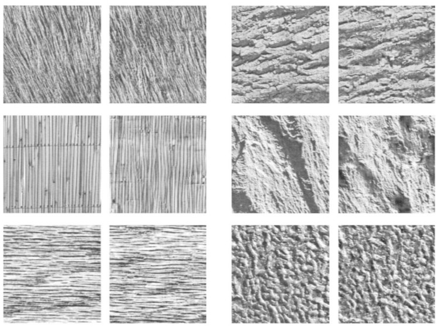

```{r, message = FALSE, warning = FALSE}
library(here)
nb_id <- "20260908"
here::i_am(paste0("reports/", nb_id, "/", nb_id, ".qmd"))

library(here)
library(dplyr)
library(tidyr)
library(ggplot2)
library(gt)

library(patchwork)
library(qs2)

knitr::opts_chunk$set(echo = F, warning = F, message = F)

# ggplot settings
theme_set(theme_minimal(base_size = 9))
```

\pagebreak 

## Introduction

Image recognition occurs through the cumulative transformation and transfer of visual information through successive regions of the brain. Image  processing starts in the primary visual cortex (V1), which contains neurons that selectively respond to simple image features like oriented edges. As image information passes through subsequent regions, such as V2, V4, and IT, each stage contains neurons selective for progressively higher-level visual features. For instance, the inferior temporal gyrus (IT), a later visual region, contains neurons that selectively respond to complex object categories, like hands or flowers [@desimone_stimulus-selective_1984].

While neurons in V1 can be effectively characterized by a few parameters (namely, the location and direction of an edge), the features relevant to other regions remain ill-defined. One approach to characterize the relevant visual features for each layer is through recording neural responses to visual texture stimuli. Visual textures are approximately homogeneous images with repeated elements, e.g., images of sand, tree bark, granite, or honeycomb (@fig-textures). Texture families can be parameterized by a set of image statistics, where image statistics are $N$th-order empirical densities of pixels [@portilla_parametric_2000]. Texture images in the same family can be visually distinct while sharing the same overall image statistics. Thus, the separability of neural responses to distinct images from different families compared to distinct images within the same family provides evidence for how visual information is summarized in visual areas. 

{#fig-textures width=50%}

Experiments with texture stimuli generally find that higher visual regions tend to be more selective for higher $N$th-order image statistics. Previously, Ziemba et al. (2016) found better within-family separation of neural responses in V1 and better between-family separation in V2 [@ziemba_selectivity_2016]. Relatedly, Okazawa et al. (2015, 2017) compared the selectivity of V2 and V4 neurons for image statistics in texture stimuli and found V4 neurons tended to be selective for higher order statistics [@okazawa_image_2015; @okazawa_gradual_2017]. Other analyses of between-region texture responses found that texture stimuli with matched higher order image statistics produced higher firing of V2 and V4 neurons compared to stimuli lacking higher order image statistics [@freeman_functional_2013; @lee_developmentally_2024; @lee_emergence_2025]. However, existing analyses tend to lack results for the entire visual processing stream, with few experimenters recording textures responses in IT. Higher level areas tend to produce sparse responses, so typical approaches in the literature, such as size-matched population analyses or single-site neuron metrics, may not produce reliable comparisons between IT and earlier visual areas. 

\pagebreak 

## References

::: {#refs}
:::
